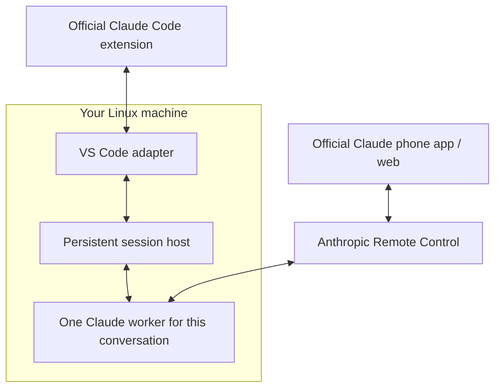

# Claude Session Sync

**One running Claude session. VS Code and phone, in sync.**

Claude Session Sync keeps Claude Code running independently of VS Code on your
Linux machine, so the official editor extension and Claude phone app can share
the same live conversation. One host manages a separate worker for each chat.

## What it solves

### Keep Claude running when VS Code disconnects

Claude Code normally runs as a child of VS Code's extension host. Closing
VS Code or restarting that host can interrupt the conversation, even though
your remote machine is still available. Anthropic documents that
[quitting the VS Code instance hosting a session takes it offline](https://code.claude.com/docs/en/remote-control#limitations).

Claude Session Sync runs the worker independently. Close your laptop, continue
from your phone, and reopen the conversation in VS Code—all against the same
running Claude process.

### Reduce “this conversation is open elsewhere” interruptions

For hosted conversations, Claude Session Sync reconnects VS Code to the existing
worker instead of starting a competing Claude process. This handles everyday
editor/phone switching and detach/reopen workflows without treating the running
conversation as an ownership conflict.

It isn't a universal fix: a surviving editor connection can still block
reattachment, and conversations owned by an external Claude process must be
closed there before migration. The host allows one attached VS Code view per
conversation, alongside native phone/web access.

### Start conversations in another folder from your phone

Native Remote Control starts from a configured project directory; it doesn't
provide an arbitrary directory picker for your remote machine.

The included `/cd-claude` skill lets you create another conversation in an
enabled folder from an existing shared chat. Choose the project, receive its
Claude link, and continue on your phone. The conversation also appears in that
project's official VS Code session history.

### Keep the official Claude interfaces

Use the official Claude Code extension and Claude phone app around one worker
per conversation. Your existing tools, project configuration, questions and
permission approvals remain part of the workflow.

**Linux · Python standard library · Official Claude interfaces · Early release**

## Get started

Use a Linux machine with Python 3.11+, systemd user services, the official Claude
Code extension, and a Claude login eligible for Remote Control. For Remote-SSH,
install on the remote machine where the extension runs.

**[Install and connect →](docs/SETUP.md)**

The integration was exercised with Claude Code **2.1.318** and Python **3.11**.
Recheck compatibility after Claude updates. Anthropic documents workspace
history support with `claudeProcessWrapper` in [extension 2.1.304 and later](https://code.claude.com/docs/en/vs-code#resume-past-conversations);
that is a prerequisite, not a claim that every later release was tested here.

Once installed:

1. Open an enabled project in VS Code and start a Claude Code conversation.
2. Enable Remote Control and open its link on your phone.
3. Close the VS Code conversation tab and continue from the phone.
4. Reopen through official Session History. The host retains the same worker.

To start another conversation from your phone, ask:

```text
/cd-claude Create a shared conversation in /path/to/another/enabled/project
```

The skill returns the new conversation's phone link. It provides folder
selection through the conversation; the mobile app's built-in new-chat button
is unchanged.

## How it works



The host owns each worker's native JSON message stream. The adapter connects
VS Code to that stream and reconnects to the same worker when a conversation is
reopened. Claude provides model access, tools, authentication and Remote
Control. Code execution and filesystem access happen on your machine.

See [architecture and operation](docs/ARCHITECTURE.md) for lifecycle, storage,
configuration and local commands.

## Defaults and boundaries

| Behavior | Default |
|---|---|
| Hosted folders | Explicit absolute paths in `projects.json` |
| Concurrent workers | Up to 32 with the example service; none prestarted |
| Idle cleanup | 72 hours of complete inactivity, checked once a minute |
| Model and effort | Existing Claude choices; creation can inherit a hosted parent |
| Editor attachments | One VS Code view per conversation, alongside phone/web |
| Host restart | Explicit resume; no automatic worker recovery or prompt replay |

After idle cleanup, history remains saved, but the phone connection is offline.
Resume from VS Code or the local client. An offline phone message cannot wake a
stopped worker in this version.

This is an early Linux integration with Claude's evolving process protocol,
tested on one deployment. Native Windows, macOS, transparent reconnect after an
idle stop, and automatic in-flight turn recovery after crashes/reboots are not
implemented. A normal standalone `claude` terminal remains a separate process.
The wrapper also has the [documented plan-mode restoration limitation](https://code.claude.com/docs/en/vs-code#resume-past-conversations).

## Related approaches

| Approach | Focus |
|---|---|
| [Native Remote Control](https://code.claude.com/docs/en/remote-control) | Phone/web access to a running Claude process |
| [claude-mux](https://github.com/pereljon/claude-mux) | Persistent terminal sessions managed through tmux |
| [Claude Persist](https://github.com/jagajaga/claude-persist) | A persistent daemon with its own VS Code chat extension |
| **Claude Session Sync** | A persistent worker shared by the official VS Code extension and native phone Remote Control |

These projects have overlapping capabilities. This project's focus is preserving
both official interfaces around the same running conversation.

## Development

The core uses only Python's standard library. Run the offline fake-Claude tests:

```sh
python3 -m unittest discover -s tests -v
```

The 30 tests exercise detach/reattach, replay filtering, completion state,
approvals, ownership checks, worker limits, NFS-stall handling and inactivity
cleanup. They do not contact Claude or submit prompts. Real-device checks on the
initial deployment covered editor/phone continuity, file reading, questions,
permission approval, phone-created sessions and service stop/resume. Full machine
reboot recovery was not tested.

`probe.py` and `check_live.py` contact a real Claude runtime when invoked. They
are separate from the offline suite.

## Privacy and project status

The host exposes a same-user Unix socket, not an inbound HTTP server. It stores
private, unencrypted event journals and diagnostic logs on your machine. Native
Remote Control uses Anthropic's service; transcript handling follows
[Anthropic's documentation](https://code.claude.com/docs/en/remote-control#connection-and-security).

Runtime state, local implementation history, generated packages and machine
configuration are excluded from this repository. Claude's proprietary runtime
is installed separately and is not distributed here.

Community project; not affiliated with or endorsed by Anthropic.

## License

[MIT License](LICENSE). Copyright (c) 2026 Prithvi Jaunjale.

The license covers this repository's code. The separately installed Claude
runtime remains subject to Anthropic's terms.
