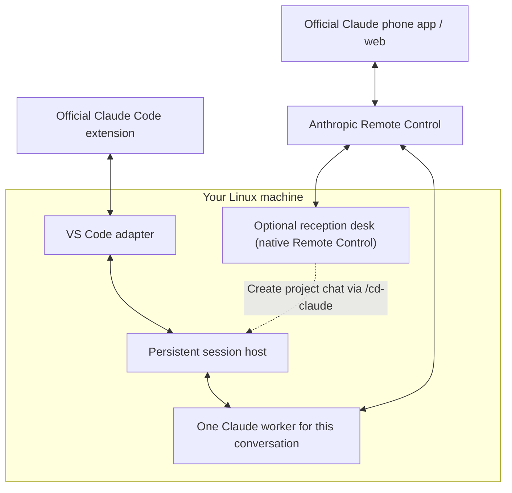

# Claude Session Sync

**Persistent Claude Code sessions for VS Code Remote-SSH and the official Claude phone app.**

Keep working on the same conversation when VS Code disconnects. Claude Session
Sync runs Claude Code independently on your Linux machine and connects the
**official VS Code extension** and **official Claude mobile app / web Remote
Control** to the same live worker. One persistent session host manages a
separate Claude process for each chat.

Built for an always-on Linux workstation or server: start in VS Code, close
your laptop, continue from your phone, then reopen the chat in the editor.
Your server must stay awake and online.

## What it solves

### Keep Claude Code running after VS Code or Remote-SSH disconnects

Claude Code normally runs as a child of VS Code's extension host. Closing
VS Code or restarting that host can interrupt the conversation, even though
your remote machine is still available. Anthropic documents that
[quitting the VS Code instance hosting a session takes it offline](https://code.claude.com/docs/en/remote-control#limitations).

Claude Session Sync runs the worker independently. Close your laptop, continue
from your phone, and reopen the conversation in VS Code—all against the same
running Claude process.

### Reattach to the same worker instead of starting a duplicate process

A reconnect should attach to the conversation already running, rather than
launch another `claude --resume` against the same transcript. For hosted chats,
Claude Session Sync reuses the existing worker. This reduces **“this conversation
is open elsewhere”** / **“This conversation is still open somewhere else”**
interruptions during everyday editor/phone switching and detach/reopen workflows.

It isn't a universal fix: a surviving editor connection can still block
reattachment, and conversations owned by an external Claude process must be
closed there before migration. The host allows one attached VS Code view per
conversation, alongside native phone/web access.

### Start conversations in another folder from your phone

CLI Remote Control server mode starts from a project directory. On a headless
Linux machine, starting chats in several projects can otherwise mean maintaining
a Remote Control server for each folder.

The included `/cd-claude` skill lets you create another conversation in an
enabled folder from an existing shared chat or the optional reception desk.
Choose the project, receive its
Claude link, and continue on your phone. The conversation also appears in that
project's official VS Code session history. You choose an explicit absolute
path, so the new chat starts with that project's working directory and
configuration rather than a shared parent folder.

Recent Claude Desktop builds also support phone-started sessions in selected
local folders; users confirmed this in [#96867](https://github.com/anthropics/claude-code/issues/96867).
This skill provides a creation route for our Linux host without depending on
Claude Desktop. It requires a running shared conversation or the optional
reception desk, plus an enabled destination folder.

### Keep the official Claude interfaces and project history

Use the official Claude Code extension and Claude phone app around one worker
per conversation. Your existing tools, project configuration, questions and
permission approvals remain part of the workflow. Phone-created hosted chats
appear in the official extension's Session History for their project; you do not
need a replacement chat extension or an all-project sidebar.

This is live process sharing on one machine. It does not copy transcripts or
synchronize repositories between computers.

**Linux · Python standard library · Official Claude interfaces · Early release**

## Fit for your workflow

| Need | What to expect |
|---|---|
| Keep a Claude Code task alive when a laptop closes or a remote editor disconnects | The worker stays on the Linux host while the editor detaches. The host and worker must keep running. |
| Continue the same chat in official VS Code and on phone | Both interfaces use the same hosted worker; one VS Code view may attach at a time. |
| Find phone-created chats in the official Claude Code session manager | Open the matching project in VS Code and use its Session History. Requires a compatible extension. |
| Start a new chat in another project from phone | Use `/cd-claude` from a running shared chat, targeting an enabled absolute folder. |
| Adopt a conversation already running in tmux, a terminal, or native background mode | Live external processes are not adopted. Close the original owner, then reopen its saved chat through the host. |
| Start new project chats from phone after all hosted workers expire | Install the optional [permanent reception desk](docs/RECEPTION_DESK.md). Its native server provides a separate phone entry point. |
| Wake a stopped worker through its old phone link, recover automatically after reboot, or use Claude Desktop as a client | Not implemented. See [defaults and boundaries](#defaults-and-boundaries). |

## Get started

Use a Linux machine with Python 3.11+, systemd user services, the official Claude
Code extension, and a Claude login eligible for Remote Control. For Remote-SSH,
install on the remote machine where the extension runs.

**[Install and connect →](docs/SETUP.md)**

The integration was exercised with Claude Code **2.1.318** and Python **3.11**.
Recheck compatibility after Claude updates. Anthropic documents workspace
history support with `claudeProcessWrapper` in [extension 2.1.304 and later](https://code.claude.com/docs/en/vs-code#resume-past-conversations);
that is a prerequisite, not a claim that every later release was tested here.

Once installed:

1. Open an enabled project in VS Code and start a Claude Code conversation.
2. Enable Remote Control and open its link on your phone.
3. Close the VS Code conversation tab and continue from the phone.
4. Reopen through official Session History. The host retains the same worker.

To start another conversation from your phone, ask:

```text
/cd-claude Create a shared conversation in /path/to/another/enabled/project
```

The skill returns the new conversation's phone link. It provides folder
selection through the conversation; the mobile app's built-in new-chat button
is unchanged.

## Optional permanent phone entry point

If every hosted conversation expires after three days of complete inactivity,
use **Claude Reception Desk** to start another project chat from your phone.
It is a small native Remote Control server in a dedicated folder, managed by a
separate systemd user service. Open its reception conversation, use `/cd-claude`,
then follow the returned link to a normal shared project conversation.

The desk allows one native helper chat at a time and stays outside hosted
idle cleanup. Project chats retain their usual worker limit and timeout.
This provides a way to create chats when no hosted worker is live; it does not
wake an expired chat through its old phone link or restore workers after reboot.

**[Set up the optional reception desk →](docs/RECEPTION_DESK.md)**

## How it works



The host owns each worker's native JSON message stream. The adapter connects
VS Code to that stream and reconnects to the same worker when a conversation is
reopened. Claude provides model access, tools, authentication and Remote
Control. Code execution and filesystem access happen on your machine.

See [architecture and operation](docs/ARCHITECTURE.md) for lifecycle, storage,
configuration and local commands.

## Defaults and boundaries

| Behavior | Default |
|---|---|
| Hosted folders | Explicit absolute paths in `projects.json` |
| Concurrent workers | Up to 32 with the example service; none prestarted |
| Idle cleanup | 72 hours of complete inactivity, checked once a minute |
| Model and effort | Existing Claude choices; creation can inherit a hosted parent |
| Editor attachments | One VS Code view per conversation, alongside phone/web |
| Host restart | Explicit resume; no automatic worker recovery or prompt replay |

After idle cleanup, history remains saved, but the phone connection is offline.
Resume from VS Code or the local client. An offline phone message cannot wake a
stopped worker in this version. The optional [reception desk](docs/RECEPTION_DESK.md)
provides a separate entry point for creating new project conversations.

This is an early Linux integration with Claude's evolving process protocol,
tested on one deployment. Native Windows, macOS, transparent reconnect after an
idle stop, and automatic in-flight turn recovery after crashes/reboots are not
implemented. A normal standalone `claude` terminal remains a separate process.
The wrapper also has the [documented plan-mode restoration limitation](https://code.claude.com/docs/en/vs-code#resume-past-conversations).

## Related approaches: tmux, Happy, Paseo and native Remote Control

Persistence and remote session creation are available in other tools. Choose
Claude Session Sync when you want to keep **both official Claude interfaces**
around the same worker on your Linux host.

| Approach | Documented workflow and overlap |
|---|---|
| [Native Remote Control](https://code.claude.com/docs/en/remote-control) | Official phone/web access to a local process. That process must remain alive; this project adds independent worker ownership and VS Code reattachment. |
| [Native Claude Desktop](https://github.com/anthropics/claude-code/issues/96867) | Recent builds support phone-started sessions in selected local folders. This project targets a Linux host with official VS Code as the editor client. |
| [tmux / screen](https://code.claude.com/docs/en/remote-control#limitations) and [claude-mux](https://github.com/pereljon/claude-mux) | Keep terminal sessions alive; claude-mux adds project/session management. A terminal multiplexer alone does not attach the official graphical VS Code panel to that worker. |
| [Happy](https://github.com/slopus/happy) and [Paseo](https://github.com/getpaseo/paseo) | Daemon-based remote agent management with their own mobile/desktop/web clients. Their documented workflows overlap with persistence and remote creation. |
| [Claude Persist](https://github.com/jagajaga/claude-persist) | A persistent daemon with its own VS Code chat extension, separate from the official extension. |
| [Code Remote Starter](https://github.com/burakgon/code-remote-starter) | A phone-accessible launcher for sessions in chosen Mac directories, using tmux and native Remote Control. |
| **Claude Session Sync** | A persistent worker shared by the **official Claude Code VS Code extension** and **official Claude phone app**, with project-scoped history and phone-driven creation in enabled folders. |

## Public reports behind this workflow

These reports describe the needs this design targets. They are motivation, not
claims that this project fixes every reported bug or supports every reporter's
platform:

- [Attach official VS Code to a running remote/background worker as a thin client (#60840)](https://github.com/anthropics/claude-code/issues/60840).
- [Keep a conversation alive after Remote Tunnel / Remote-SSH disconnects (#97754)](https://github.com/anthropics/claude-code/issues/97754).
- [Avoid duplicate `claude --resume` workers after a Remote-SSH reconnect (#96352)](https://github.com/anthropics/claude-code/issues/96352).
- [Select a project without maintaining one Remote Control server per folder (#100303)](https://github.com/anthropics/claude-code/issues/100303).
- [Find Remote Control-created sessions in official VS Code history (#106389)](https://github.com/anthropics/claude-code/issues/106389).

## Development

The core uses only Python's standard library. Run the offline fake-Claude tests:

```sh
python3 -m unittest discover -s tests -v
```

The 30 tests exercise detach/reattach, replay filtering, completion state,
approvals, ownership checks, worker limits, NFS-stall handling and inactivity
cleanup. They do not contact Claude or submit prompts. Real-device checks on the
initial deployment covered editor/phone continuity, file reading, questions,
permission approval, phone-created sessions and service stop/resume. Full machine
reboot recovery was not tested.

`probe.py` and `check_live.py` contact a real Claude runtime when invoked. They
are separate from the offline suite.

## Privacy and project status

The host exposes a same-user Unix socket, not an inbound HTTP server. It stores
private, unencrypted event journals and diagnostic logs on your machine. Native
Remote Control uses Anthropic's service; transcript handling follows
[Anthropic's documentation](https://code.claude.com/docs/en/remote-control#connection-and-security).

Runtime state, local implementation history, generated packages and machine
configuration are excluded from this repository. Claude's proprietary runtime
is installed separately and is not distributed here.

Community project; not affiliated with or endorsed by Anthropic.

## License

[MIT License](LICENSE). Copyright (c) 2026 Prithvi Jaunjale.

The license covers this repository's code. The separately installed Claude
runtime remains subject to Anthropic's terms.
