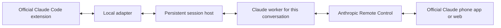

# Claude Session Sync

**One running Claude session. VS Code and phone, in sync.**

Start a conversation in the official Claude Code extension. Close VS Code.
Continue from the Claude app on your phone. Reopen the conversation in VS Code
and pick up the same live session, with messages and tool activity intact.

Claude Session Sync keeps the Claude process on your Linux machine independent
of the editor. The official VS Code extension and Claude's native Remote Control
share that process. Each live conversation has its own worker; one host manages
them all.

**Linux · Python standard library · Official Claude interfaces · Early release**

## Why use it?

Remote Control already connects Claude Code to your phone. When VS Code owns
the process, [quitting that VS Code instance takes its session offline](https://code.claude.com/docs/en/remote-control#limitations).
Claude Session Sync moves ownership to a persistent local host and lets the
editor attach to it again.

This is for people who want the official Claude Code panel, the official Claude
phone app, and an always-on machine to share a conversation without keeping an
editor window open.

## What you get

- **One live conversation across editor and phone.** Messages, tool activity,
  questions and permission prompts use the native Claude interfaces.
- **Work that continues after VS Code disconnects.** Closing a conversation tab
  or losing the editor connection detaches the view and leaves its worker alive.
- **Native project history.** Reopen conversations through Claude Code's own
  Session History in the current workspace.
- **New conversations in another folder from your phone.** Use `/cd-claude` in a
  running shared conversation to choose an enabled project and get a new link.
- **Cleanup after three days of complete inactivity.** Pending approvals,
  questions, queued messages and unfinished background tasks prevent cleanup.
- **Explicit project selection.** Enable the folders you want to host. Other
  VS Code projects continue to launch Claude normally.

## Get started

Use a Linux machine with Python 3.11+, systemd user services, the official Claude
Code extension, and a Claude login eligible for Remote Control. For Remote-SSH,
install on the remote machine where the extension runs.

**[Install and connect →](docs/SETUP.md)**

The integration was exercised with Claude Code **2.1.318** and Python **3.11**.
Recheck compatibility after Claude updates. Anthropic documents workspace
history support with `claudeProcessWrapper` in [extension 2.1.304 and later](https://code.claude.com/docs/en/vs-code#resume-past-conversations);
that is a prerequisite, not a claim that every later release was tested here.

Once installed:

1. Open an enabled project in VS Code and start a Claude Code conversation.
2. Enable Remote Control and open its link on your phone.
3. Close the VS Code conversation tab and continue from the phone.
4. Reopen through official Session History. The host retains the same worker.

To start another conversation from your phone, ask:

```text
/cd-claude Create a shared conversation in /path/to/another/enabled/project
```

The skill returns the new conversation's phone link. It provides folder
selection through the conversation; the mobile app's built-in new-chat button
is unchanged.

## How it works



The host owns each worker's native JSON message stream. The adapter connects
VS Code to that stream and reconnects to the same worker when a conversation is
reopened. Claude provides model access, tools, authentication and Remote
Control. Code execution and filesystem access happen on your machine.

See [architecture and operation](docs/ARCHITECTURE.md) for lifecycle, storage,
configuration and local commands.

## Defaults and boundaries

| Behavior | Default |
|---|---|
| Hosted folders | Explicit absolute paths in `projects.json` |
| Concurrent workers | Up to 32 with the example service; none prestarted |
| Idle cleanup | 72 hours of complete inactivity, checked once a minute |
| Model and effort | Existing Claude choices; creation can inherit a hosted parent |
| Editor attachments | One VS Code view per conversation, alongside phone/web |
| Host restart | Explicit resume; no automatic worker recovery or prompt replay |

After idle cleanup, history remains saved, but the phone connection is offline.
Resume from VS Code or the local client. An offline phone message cannot wake a
stopped worker in this version.

This is an early Linux integration with Claude's evolving process protocol,
tested on one deployment. Native Windows, macOS, transparent reconnect after an
idle stop, and automatic in-flight turn recovery after crashes/reboots are not
implemented. A normal standalone `claude` terminal remains a separate process.
The wrapper also has the [documented plan-mode restoration limitation](https://code.claude.com/docs/en/vs-code#resume-past-conversations).

## Related approaches

| Approach | Focus |
|---|---|
| [Native Remote Control](https://code.claude.com/docs/en/remote-control) | Phone/web access to a running Claude process |
| [claude-mux](https://github.com/pereljon/claude-mux) | Persistent terminal sessions managed through tmux |
| [Claude Persist](https://github.com/jagajaga/claude-persist) | A persistent daemon with its own VS Code chat extension |
| **Claude Session Sync** | A persistent worker shared by the official VS Code extension and native phone Remote Control |

These projects have overlapping capabilities. This project's focus is preserving
both official interfaces around the same running conversation.

## Development

The core uses only Python's standard library. Run the offline fake-Claude tests:

```sh
python3 -m unittest discover -s tests -v
```

The 30 tests exercise detach/reattach, replay filtering, completion state,
approvals, ownership checks, worker limits, NFS-stall handling and inactivity
cleanup. They do not contact Claude or submit prompts. Real-device checks on the
initial deployment covered editor/phone continuity, file reading, questions,
permission approval, phone-created sessions and service stop/resume. Full machine
reboot recovery was not tested.

`probe.py` and `check_live.py` contact a real Claude runtime when invoked. They
are separate from the offline suite.

## Privacy and project status

The host exposes a same-user Unix socket, not an inbound HTTP server. It stores
private, unencrypted event journals and diagnostic logs on your machine. Native
Remote Control uses Anthropic's service; transcript handling follows
[Anthropic's documentation](https://code.claude.com/docs/en/remote-control#connection-and-security).

Runtime state, local implementation history, generated packages and machine
configuration are excluded from this repository. Claude's proprietary runtime
is installed separately and is not distributed here.

A license has not yet been selected. Community project; not affiliated with or
endorsed by Anthropic.
